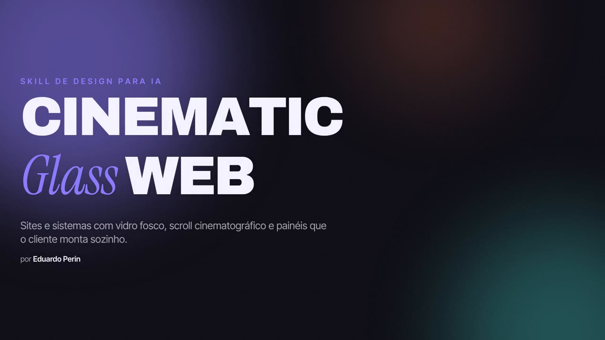
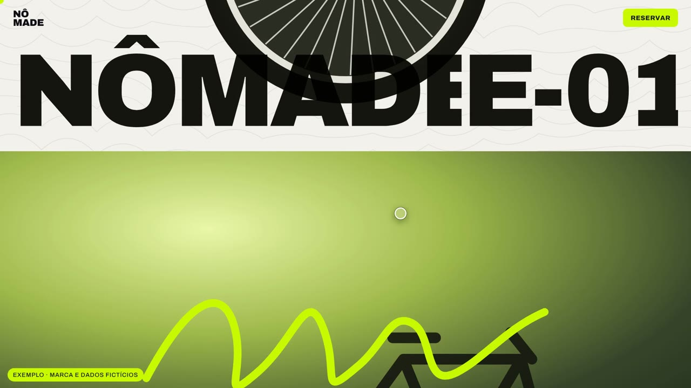
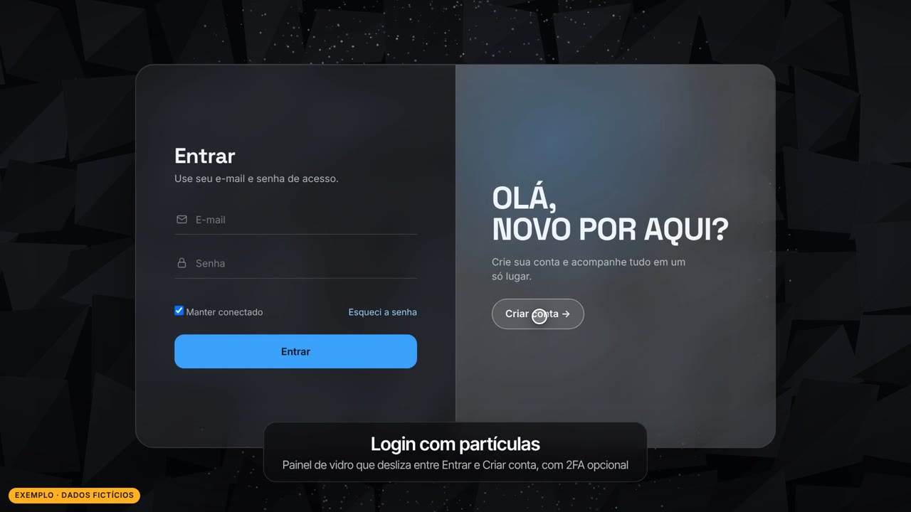
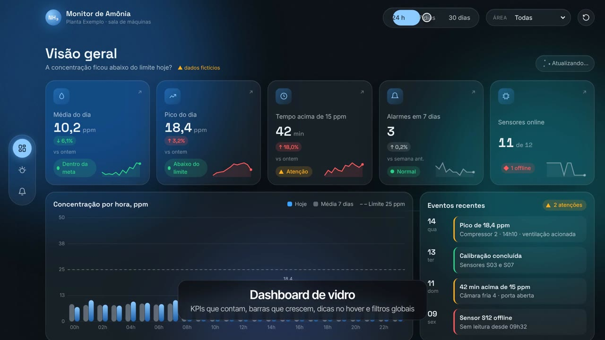
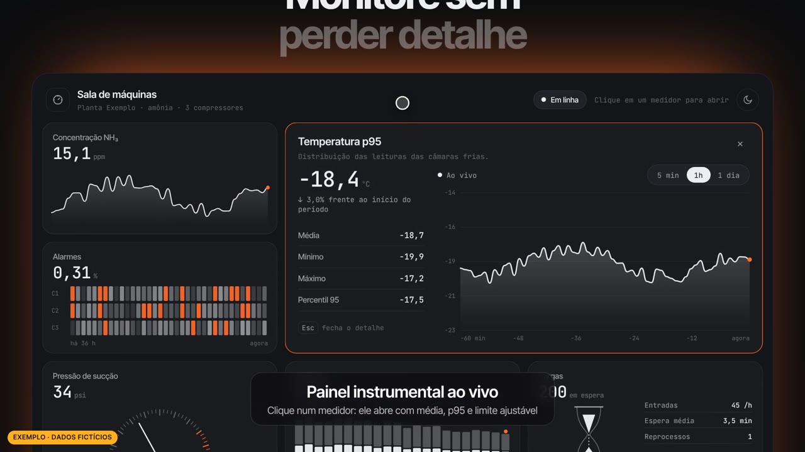
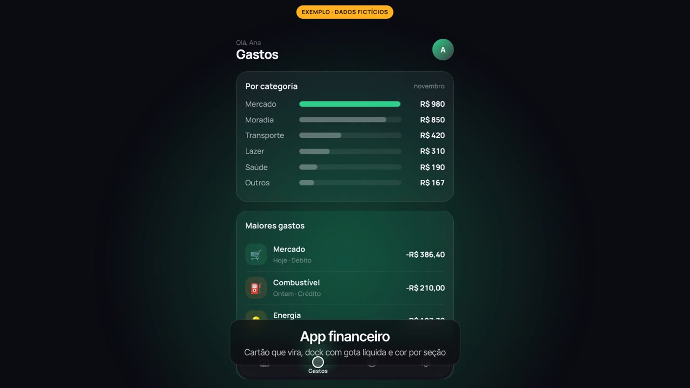
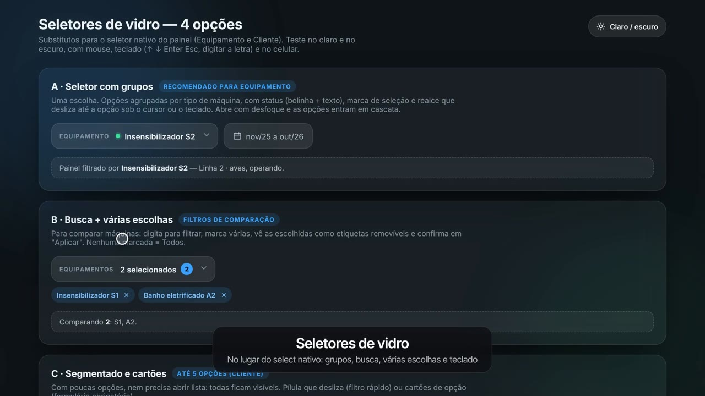
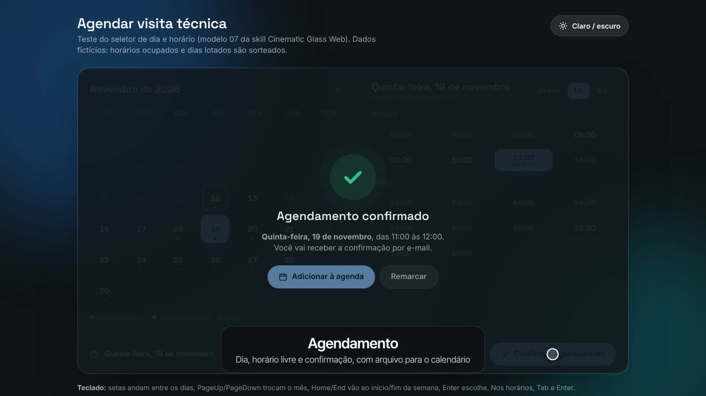
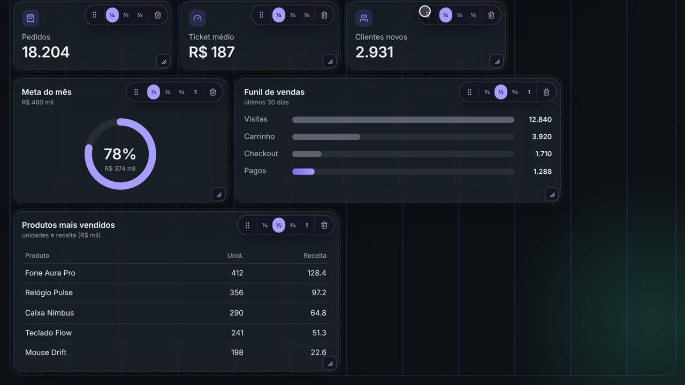

# Cinematic Glass Web

**Skill de design para IA** que faz sites e sistemas com **vidro fosco**, **scroll cinematográfico** e **painéis que o cliente monta sozinho**. Funciona no Claude, Claude Code, Antigravity e Cursor.

Por **Eduardo Perin**.

## Veja em ação

▶️ **[Vídeo horizontal de 1m35s](video/cinematic-glass-web-horizontal.mp4)** · **[versão vertical 9:16 de 37s](video/cinematic-glass-web-vertical-9x16.mp4)** (baixe ou assista direto no GitHub).

## O que a skill faz

1. **Pergunta antes de codar**: tipo de sistema, cores e tema, intensidade do movimento, login e painel editável.
2. **Escolhe o padrão certo** para cada tipo (landing, dashboard, app, loja, CRM) e pesquisa referências novas.
3. **Constrói** com vidro fosco, GSAP + Lenis, partículas, tema claro/escuro e acessibilidade (teclado e movimento reduzido).

| | |
|---|---|
| 48 | efeitos catalogados com código |
| 38 | padrões de interface |
| 7 | modelos prontos + kit React |

## Prévias

| Landing cinematográfica | Login com partículas |
|---|---|
|  |  |
| **Dashboard de vidro** | **Painel instrumental ao vivo** |
|  |  |
| **App financeiro** | **Seletores de vidro** |
|  |  |
| **Agendamento (dia e hora)** | **Painel que o cliente monta** |
|  |  |

## Exemplos para abrir

Baixe a pasta [`exemplos/`](exemplos/) e abra qualquer `.html` no navegador (são arquivos únicos, sem instalação):

- `01-landing-cinematografica.html`
- `02-dashboard-vidro.html`
- `03-app-financeiro.html`
- `04-login-particulas.html`
- `05-painel-instrumental.html`
- `06-seletores-vidro.html`
- `07-agendamento.html`

Todos usam marca e dados **fictícios**.

## Destaques

- **Seletores de vidro**: no lugar do `select` nativo. Grupos, busca, várias escolhas, "usados recentemente" e teclado.
- **Painel montável**: o cliente arrasta, redimensiona (tamanho pronto ou livre), remove e adiciona funções.
- **Agendamento**: calendário, horários livres, duração e arquivo `.ics`.
- **Troca de tema** que escorre pela tela, e **dock** com gota líquida.

## Como adquirir

A skill completa (SKILL.md, catálogo de efeitos, sistemas, modelos e kit React) é entregue a quem comprar a licença.
Para comprar, abra uma [issue neste repositório](../../issues/new) com o título "Quero a skill" e eu retorno.

## Como usar (depois de adquirir)

- **Claude**: Configurações → Capacidades → Skills → enviar o arquivo da skill.
- **Claude Code**: copie a pasta `cinematic-glass-web` para `~/.claude/skills/`.
- **Antigravity / Cursor**: coloque a pasta no diretório de skills ou regras do projeto e peça: "crie um site usando a skill Cinematic Glass Web".

---

© Eduardo Perin. Todos os direitos reservados. Veja [LICENSE.md](LICENSE.md).
